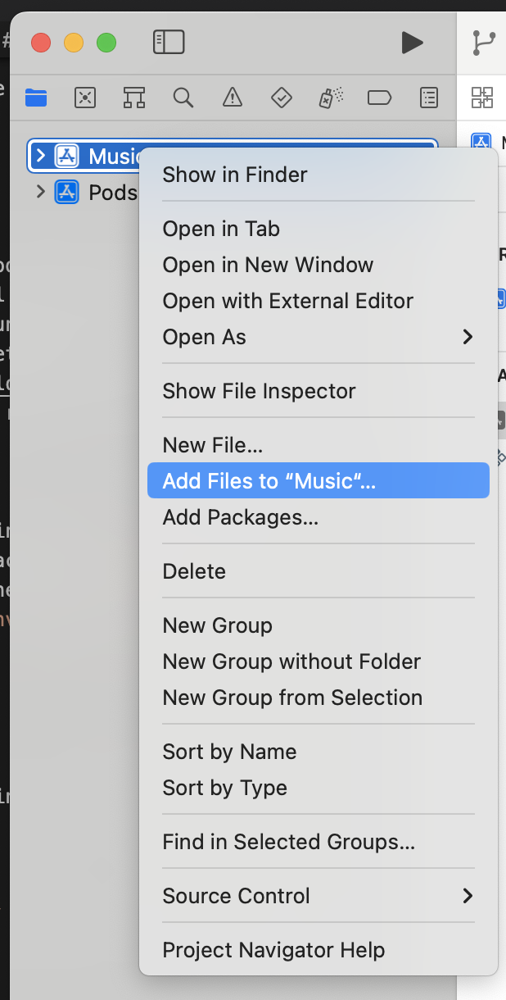
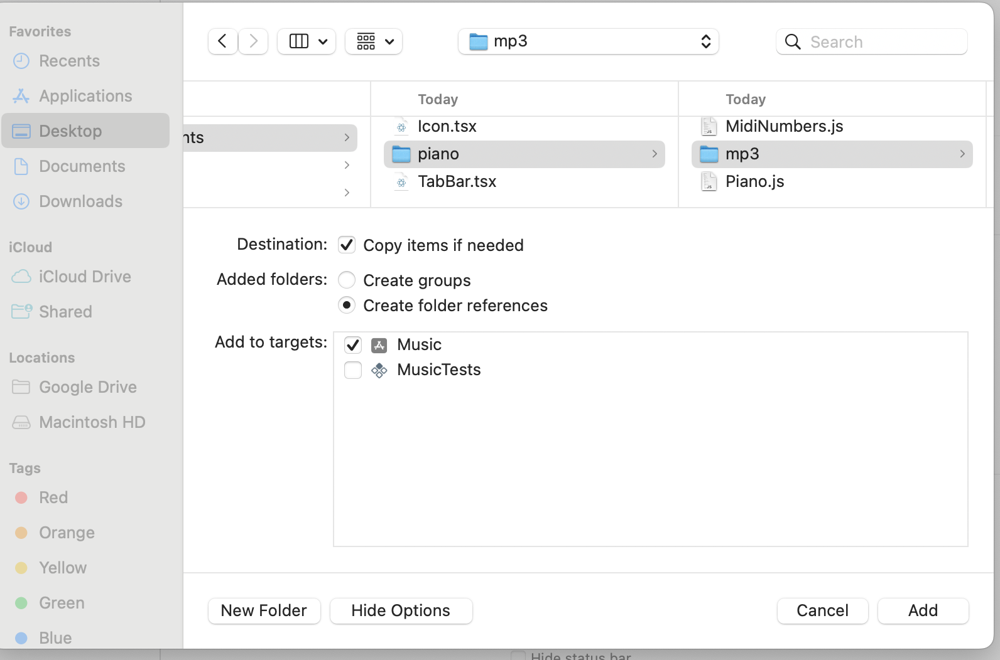

# MusicAI (mobile)

MusicAI is the React Native app from my Computer Science graduation project (2023). You play a short melody on an on-screen piano, and a pretrained AI model continues it. You can then play the result back and view it as sheet music.

The app uses two backends:

- [MusicAI-backend](https://github.com/Medkuee/MusicAI-backend): Node.js/Express API for accounts and saved recordings
- [MusicAI-backend-Python-](https://github.com/Medkuee/MusicAI-backend-Python-): Flask server that continues the melody with Google Magenta's pretrained Melody RNN

## What works

- **Sign up and log in.** The login token is stored with AsyncStorage, and the splash screen uses it to skip the login screen.
- **Piano.** All 88 keys, split into six ranges you switch between with arrows. Each key plays a bundled piano sample.
- **Recording.** Press **Play**, then play 10 notes. The app records each note's key, start time and duration.
- **Music generation.** After the 10th note, the recording is saved to the Node backend and sent to the Python backend, which continues the melody and writes MIDI and MusicXML files.
- **Preview.** Replays your recorded notes. It also opens two WebView pages: a MIDI player for the generated piece ([html-midi-player](https://github.com/cifkao/html-midi-player)) and a sheet music view ([OpenSheetMusicDisplay](https://opensheetmusicdisplay.org/)).
- **My recordings.** The Search tab lists your saved recordings, newest first.
- **Profile screen.** Shows your name and email, and has a working logout.

## Not finished

- The search box on the Search tab doesn't filter anything.
- Favourite, Wallet and Notifications are placeholder screens.
- On the More screen, only Logout works. "Edit Profile" just shows a toast, and the other menu items do nothing.
- Recordings are always exactly 10 notes, and generation settings can't be changed from the app.
- I only ran the app on the iOS Simulator. The Android project is the default React Native template, and the piano samples aren't set up for Android.
- There are no real tests, and `yarn lint` and `tsc` report errors (mostly formatting, unused variables and missing types).

## How it connects to the backends

```
Piano (10 notes)
  ├─ POST {BACKEND_URL}/createMusic      → saves notes, returns music id
  └─ POST {BACKEND_PYTHON}/create-music  → { name: <music id>, notes }
        Magenta continues the melody and writes <id>.mid and <id>.mxl
        into src/screens/main/guest/guestFavoriteScreen/music-output/

Preview / Search
  ├─ GET {BACKEND_URL}/profile           → user + their recordings
  ├─ GET {BACKEND_URL}/music/:id         → one recording (owner only)
  └─ WebViews load music-output/<id>.mid and <id>.mxl
```

The Python server writes the generated files directly into this repo's `music-output` folder. The WebViews load them from there through the Metro dev server. This means generation only works in a development build, with Metro, both backends and the simulator on the same machine. It was good enough for a demo, but a real version would serve the files from the backend. A few sample outputs are committed in `music-output`.

All requests send the token as `Authorization: Bearer <token>`.

## Tech stack

- React Native 0.71, TypeScript and JavaScript
- React Navigation, NativeBase, Context and reducers for app state
- axios, AsyncStorage, react-native-dotenv
- react-native-sound for the piano samples
- react-native-webview with html-midi-player (loaded from a CDN, so it needs internet) and OpenSheetMusicDisplay (bundled)

## Running locally

You need macOS with Xcode, CocoaPods and Watchman, and Node 16–18. Both backends should already be running (see their READMEs). Clone all three repos into the same parent folder, because the Python backend writes into `../MusicAI-mobile` by default.

```bash
yarn install
yarn pod                 # cd ios && pod install
cp .env.example .env     # BACKEND_URL=http://localhost:3000, BACKEND_PYTHON=http://127.0.0.1:5000
yarn start               # Metro, keep it running
yarn ios
```

If `yarn ios` fails, open `ios/Music.xcworkspace` in Xcode and build from there.

### Known setup issues

- **`yarn install` fails with "repository 'https://github.com/paulrosen/MIDI.js.git' not found".** The unused `@slnsw/react-sheet-music` dependency pulls in a GitHub repo that no longer exists. Removing it fixes the install (`yarn remove @slnsw/react-sheet-music`). Nothing in `src/` imports it.
- **Xcode can't find the `mp3` folder.** Remove the `mp3` reference from the project and add `src/components/piano/mp3` again with "Add Files to Music…":

  
  
